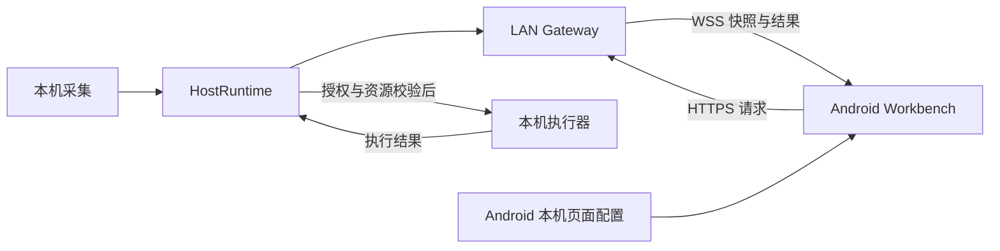

# Desklet 架构

状态：连接基础已实现；来源采集、动作与工作台为后续目标。2026-10-16。

## 双端直连

桌面 Agent 同时承载本机状态、设备授权、LAN 监听和有限动作执行。Android 承载工作台、来源选择、页面与组件偏好。

HostRuntime 与 LAN Gateway 嵌入桌面进程；关闭设置窗口后可继续在托盘运行。没有独立部署的 Core 或 Broker。

## 技术栈

| 部分 | 选择 | 原因 |
| --- | --- | --- |
| 桌面外壳 | Tauri + React / TypeScript | 复用现有设置、托盘与平台能力 |
| 本机运行时与 LAN | Rust | 复用现有采集与执行，统一网络实现 |
| Android 展示 | Flutter / Dart | 复用工作台、点阵、主题与适配 |
| Android 原生能力 | Kotlin + OkHttp | 连接生命周期、安全存储和系统组件 |
| 通信 | HTTPS + WSS + JSON | 快照、命令与结果共享一个 TLS 监听端口 |
| 桌面前端工具 | pnpm | 在创建可构建工程时提交对应锁文件 |

首批来源复用 Codex 会话与额度采集，以及 Sub2API 用量采集。依赖版本、Android 目标版本和打包标识在连接原型阶段落定。复杂的非敏感配置使用结构化 YAML；密钥和令牌存系统安全存储，不写进配置或仓库。

## 四个核心模块

| 模块 | 对调用者提供的接口 | 内部实现 |
| --- | --- | --- |
| HostRuntime | 取得某设备可见的状态；执行该设备的有限动作 | 采集调度、快照、新鲜度、隐私裁剪、授权、校验、命令去重与执行 |
| LAN Session | 配对、连接、订阅、提交动作、断开 | 发现、TLS、公钥固定、凭据、重连、心跳与版本协商 |
| WorkbenchStore | 展示状态、选择来源、打开会话与入口 | 缓存、来源绑定、错误映射、稳定资源身份与原生桥接 |
| LayoutWorkspace | 管理页面与组件、开始编辑、提交或取消、解析当前页 | 网格约束、参数、横竖屏摆放、撤销、草稿与本机保存 |

Tauri 负责装配运行时、设置、托盘、登录启动和更新；HostRuntime 不依赖窗口。WorkbenchScreen 不依赖 Orbit 的 InboxController。网络层不感知页面尺寸。

## 配置与数据归属

**Host 持有：** Codex / API 用量来源配置及凭据、本机应用路径与 URL、快捷入口定义、共享字段和各设备许可。每次执行重新校验，删除入口或撤销许可立即生效。

**Android 持有：** 已配对 Host、来源选择、会话分组、入口显示顺序、页面列表、各实例参数与摆放、配色、常亮与显示偏好。绑定保存稳定 ID，不保存执行路径或依赖 IP 的引用。

Host 的连接状态、Source 的新鲜度和页面的可见性相互独立。多个组件使用同一 Source 时合并订阅；隐藏组件不能关闭其他设备仍在使用的来源。

## Android 生命周期

Flutter 负责页面和组件渲染。Kotlin ConnectionRuntime 统一管理发现、TLS 固定、网络切换与快照持久化，经 EventChannel / MethodChannel 给 Flutter 提供状态与动作接口。发现模块可通过 JNI 复用 Rust，具体桥接方案需要验证。

Android 系统桌面组件读取同一个原生快照存储，避免另建连接。普通模式退出前台后允许暂停，恢复前台立即同步；用户显式开启桌面屏模式时，Activity 可见期间保持连接与常亮。

App 不可见时持续刷新需要单独验证前台服务、通知和平台要求。权限拒绝、息屏、系统回收和新 Android 局域网权限都属于真机验收范围。

## 从 Orbit 提取

来源仓库为 `orbit`，下表是提取路径，不是本仓库的运行依赖。

| 原路径或模块 | 提取方式 |
| --- | --- |
| `agents/desktop` | 复用 Tauri 外壳与设置；连接设置换为配对与设备许可 |
| `codex.rs`、`usage.rs` | 复用采集规则，改用 Desklet 领域类型 |
| `commands.rs`、`shortcuts.rs` | 复用资源校验与本机打开能力，替换授权与命令信封 |
| `runtime.rs` | 保留采集调度；MQTT 状态机替换为 LAN 监听与会话管理 |
| `nodes/app` | 复用工作台、点阵、主题和适配；移除 InboxController 依赖 |
| `nodes/android` | 复用原生全屏、组件与设备适配；迁入独立 Android 工程 |
| Core 的新鲜度与隐私裁剪规则 | 保留行为与关键用例，迁到 HostRuntime |

不整体复制 Orbit wire / Protobuf 协议、收件箱和 Core Console。首次提取允许复制成熟实现；出现实际共享变化后再决定公共库。

## 独立产品约束

Desklet 使用独立的 Android applicationId、桌面 bundle ID、配置目录、设备身份、签名和更新通道，可与 Orbit 并存。当前标识为 `app.desklet.agent` 与 `app.desklet.workbench`。

平台差异通过 Adapter 隔开：应用发现、打开应用、安全存储、登录启动与来源采集。首版按实际需求实现，不预建通用插件框架。

macOS 安装路径需验证签名、公证与本地网络授权。Windows 需验证签名安装包、防火墙、凭据存储和 Codex 发现 / 深链。复用源代码不能代替对应平台的真机证据。

## 详细契约

- [LAN 协议](protocol.md)：身份与地址、发现、配对、同步及动作语义。
- [工作台](workbench.md)：页面、组件参数、手势和本机存储。
- [开发计划](roadmap.md)：实现顺序与验收条件。

## 当前代码边界

- `crates/host`：稳定身份、设备审批、邀请有效期、凭据摘要、撤权和最小快照；不依赖 UI 或网络。磁盘锁防止重复进程覆盖配置。
- `crates/lan`：嵌入式 TLS 监听、设备认证、WSS、发现、邀请 URI；没有单独部署的服务。桌面启动时从系统钥匙串读取 TLS 私钥，证书续签保持原 SPKI。
- `apps/desktop`：React 设备管理界面与 Tauri 托盘；关闭窗口继续运行，菜单栏可打开或退出。启动失败时保留窗口显示可操作提示。
- `apps/android`：Flutter 连接界面；Kotlin 管理 HTTPS / WSS、发现、Keystore 凭据与后台暂停。当前单电脑，不缓存业务快照、不执行远程动作。

当前没有引入 Orbit 源码或运行依赖，没有额外后端、MQTT 或共享插件框架。页面与组件编辑在连接层稳定后再实现。
