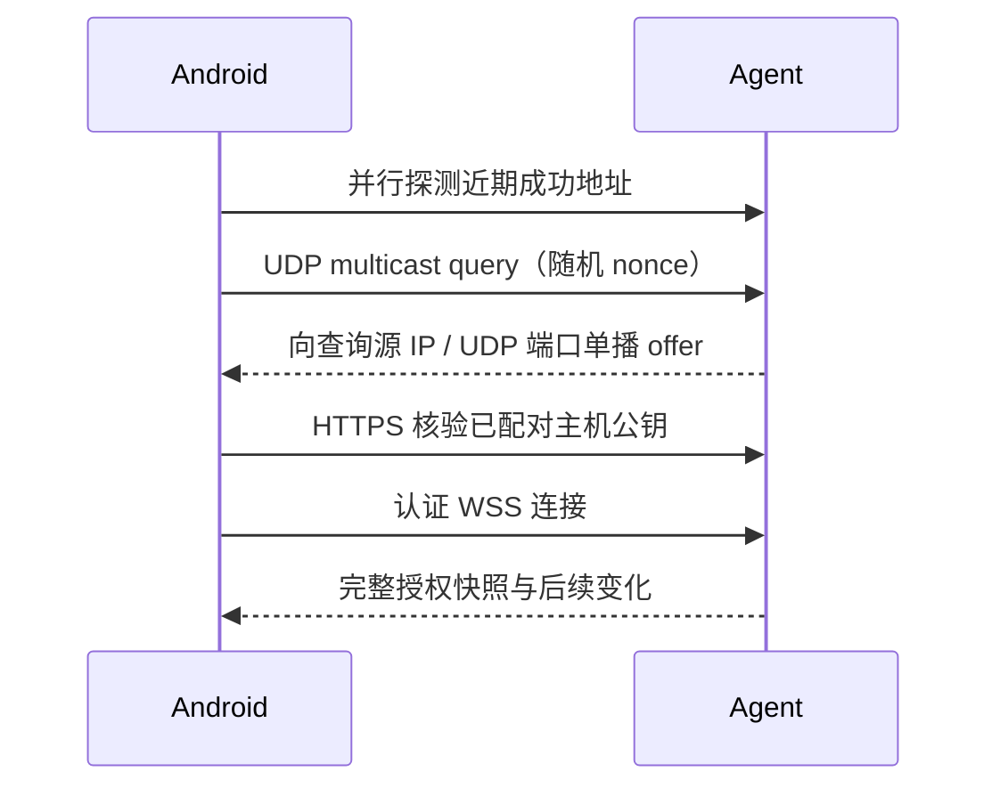

# LAN 协议草案

状态：连接、授权快照与有限动作已有第一版实现，其余为目标草案。下列路径、字段和时间值是建议契约，需在连接原型中验证后冻结。2026-10-16。

## 身份与地址分离

`host_id` 是 Host 安装时生成的稳定随机 ID，持久主机公钥建立信任。Endpoint 是可变的地址、端口与接口信息；同一 Host 可以有多个 Endpoint。

配对后保存 Host 身份、公钥与近期成功地址。IP 变化时，Android 重新发现候选地址，再核验原公钥。匹配后更新地址，无需重新配对。名称相同或 IP 相同不能继承信任。

如果 Host 换密钥，应重新配对，或使用旧身份认证的换钥流程。仅凭新发现消息不能替换公钥。

## 发现

采用产品自己的 UDP 多播 query / offer，参考 [LocalSend 研究](research/localsend-discovery.md)。DeskBar 不复用 LocalSend 的组地址、端口或登记接口。产品组地址和默认端口尚待选择。

- query 携带随机 nonce；回应 offer 绑定本次 nonce。
- offer 仅含显示名、实例标识、实际 HTTPS 端口、协议版本与公钥摘要线索。
- 接收方从数据报来源取得地址线索；消息字段本身不提供信任。
- offer 不触发继续回应，避免回应循环。
- 启动和网络变化可发送有限次公告；公告与查询响应应可区分。
- 在选定的 Wi-Fi / 以太网接口逐接口收发；处理 IPv4 / IPv6 候选及链路本地地址的接口范围。
- 网络变化后重绑接口；加入随机抖动、有限重试和源地址限流。
- Android 是业务客户端，不为发现回调开放 HTTP 服务器。

已配对地址探测与多播并行。是否升级查找按目标 Host 判断，不能因为另一台电脑回应就停止寻找目标。在线状态由认证连接与心跳决定，发现记录只提供候选。

## 回退与端口

发现端口固定。HTTPS 优先使用稳定默认端口；端口占用时可改用其他端口，并通过 offer、二维码、已存地址或手工地址传递实际值。

目标仍未找到时，提供可取消、有总时限的局部网段扫描。单端口扫描找不到任意随机端口，扫描范围、并发、超时与重试需要真机验证，不直接复制 LocalSend 的参数。

mDNS 留作后续 Adapter。二维码与手工地址始终可用。客户端隔离或防火墙阻断直连时，换发现协议或扫描都不能消除限制。

## 配对与信任

桌面创建持久安装身份与 TLS 密钥。支持三条配对路径：

1. **局域网自动发现（默认）**：电脑响应 IPv4 多播 query，offer 携带主机公钥摘要、候选地址、配对会话 ID、256 位一次性秘密和两分钟过期时刻。Android 点击电脑名称后先核验可信公钥，再提交秘密；桌面只需确认一次，审批后签发设备凭据。发现 offer 不能替换已保存的主机 pin。
2. **扫码 / 粘贴备用邀请**：电脑显示主机公钥摘要、候选地址、配对会话 ID 与 256 位一次性秘密；Android 扫描或粘贴完整邀请后执行同样的核验和审批流程。
3. **配对码**：供无摄像头设备使用，通过已审查的 PAKE 实现核验身份，再固定主机公钥。候选为 SPAKE2+；跨语言库、协议上下文绑定与 TLS 公钥绑定尚未验证。

短配对码不能只作为普通 HTTPS 请求里的密码。PAKE 上下文绑定产品、版本、双方身份和本次 TLS 公钥；限制尝试次数，失败后由桌面重新生成。

配对成功签发独立的 256 位随机设备令牌。Android 用系统安全存储保护令牌，Host 保存摘要与设备许可。撤销设备立即关闭相关连接；下一次请求重新检查许可。

HTTPS / WSS 固定主机 SPKI，计划支持 TLS 1.2 / 1.3 以兼容旧 Android。同一密钥下续签证书不改变信任。不跟随跨主机重定向；凭据不放 URL 或日志。后续所有受保护请求均从设备凭据推导身份。

参考：[SPAKE2+ RFC 9383](https://www.rfc-editor.org/rfc/rfc9383)。这是设计选型，连接原型完成前不宣称配对方案已验证。

## 状态同步

每个 Host 维护单调递增 `revision`，进程启动产生新 `epoch`。认证订阅与初始快照在同一序列内完成，避免先拉再订阅丢失变化。

首版在初始连接和状态变化时发送按设备许可裁剪的完整快照。限制近期会话数量并单独给出总数；暂不引入增量补丁和事件重放。

| 数据 | 核心字段与规则 |
| --- | --- |
| Host | `host_id`、`epoch`、`revision`、`server_time`、协议版本 |
| Source | `source_id`、健康、`observed_at`、`fresh_until`；各来源独立判断 |
| 用量 | 结构化数值、重置时刻、计费日与时区；金额用整数微单位或十进制字符串 |
| Session | `provider`、`session_id`、资源版本、状态和获准字段 |
| Shortcut | `shortcut_id`、目录版本、名称、类型、图标摘要；执行路径只留在 Host |
| Capability | 当前设备可用动作与禁用原因；执行时再次校验 |

资源使用 `(host_id, provider, resource_id)` 标识，不发送 rollout 路径、账号令牌或完整本地目录。图标按认证后的内容摘要缓存。

时间字段采用 UTC，显示按设备时区格式化。Android 依据 `server_time` 校正倒计时。来源失败保留最后值并标记过期；心跳或重连不延长来源新鲜度。达到额度重置时间后显示等待刷新，不自行变为 100%。

明确收到撤权后清除对应敏感缓存；普通断线允许保留带离线标记的缓存。

## 建议接口

| 接口 | 用途 |
| --- | --- |
| `POST /v1/pairing/*` | 仅在桌面发现 offer 或备用邀请开启配对会话时登记；完成 TLS pin 核验与电脑审批 |
| `GET /v1/events` → WSS | 认证、版本协商、完整快照、心跳和动作结果 |
| `GET /v1/snapshot` | 显式刷新与诊断，同一份授权快照 |
| `POST /v1/commands` | 返回 `command_id` 与当前执行状态 |
| `GET /v1/commands/{id}` | 查询本设备提交的命令 |
| `GET /v1/assets/{hash}` | 按当前设备许可读取图标 |

路径尚未冻结；[protocol 目录](../protocol/README.md) 后续承载 Schema 和兼容消息样例。

## 动作语义

首版只支持 `open_session` 与 `open_shortcut`。Android 发送目标 ID，不传任意本机命令、应用路径或执行 URL。

请求携带 `command_id`、`host_id`、`host_epoch`、目标 ID、目标版本与短有效期。建议最长 10 秒；客户端用校正后的时间生成，Host 按自己的时间校验。校验目标版本，避免无关来源刷新使命令失效。

- 同一设备的同一 `command_id` 与内容只尝试一次，重复提交返回已有结果。
- 相同 ID 携带不同内容必须拒绝。
- 断线不排队，重连不自动重放。
- 进程重启改变 epoch，拒绝旧命令。
- 执行中崩溃只能报告结果未知，不能承诺外部副作用恰好一次。
- 结果保留短期查询窗口，按设备隔离；窗口长度待定。

| 结果 | 含义 |
| --- | --- |
| `accepted` | 校验通过并接收，尚不代表打开成功 |
| `succeeded` | OS 接受打开请求，不承诺窗口已经前置 |
| `failed` | 已知失败，显示可操作原因 |
| `unknown` | 无法确定副作用；不得自动重试 |

## 兼容与验证

主版本不兼容时提示更新。次版本通过能力协商；新增未知字段可忽略，未知动作拒绝。后续 CI 检查 Schema、生成类型与跨端消息样例一致。

优先验证：Android 9 与普通手机、macOS / Windows、多网卡、VPN、换 IP、多播受阻、端口占用、错误公钥、过期配对、撤权和执行中退出。平台权限与防火墙同样属于连接路径，扫码不绕过系统权限。

## v1 连接实现子集

本节记录代码当前行为，前文的完整协议仍需按阶段验证。

- IPv4 多播组 `239.77.68.76`，UDP `42831`；JSON query 包含 `product=deskbar`、`version=1`、`type=query`、随机 `nonce`。offer 回显 nonce，提供 `host_id`、`name`、实际 `port`、`pin`、配对会话、256 位秘密和过期时刻。响应向查询源单播，按源 IP 两秒内最多一次。发现不授予信任，Android 点击后仍须 TLS pin 核验和电脑审批。当前只在启动时绑定接口，尚不覆盖 IPv6 和网络切换重绑。
- 连接邀请为 `deskbar://pair` URI，携带版本、Host、名称、SPKI pin、候选 HTTPS 地址、配对会话、256 位秘密和过期时刻。自动发现 offer 使用相同字段，Android 点击电脑后在本机组装 URI；扫码 / 粘贴保留为备用入口，尚无短码 PAKE。
- `POST /v1/pairing/request` 接收 `session_id`、`secret`、`claim`（客户端 256 位随机秘密）、`name`，返回 `id`、`name`、`expires_at`。相同邀请与 claim 重试返回原请求，其他请求无法再次消费邀请。
- `POST /v1/pairing/status` 接收 `request_id` 与 `claim`；审批前返回 `token: null`，电脑审批后在邀请有效期内返回独立 256 位设备令牌。过期、取消与移除后不可再领取。
- `GET /v1/snapshot` 与 `GET /v1/events`（WSS）使用 Authorization Bearer。WSS 订阅先登记再读取初始完整快照，十秒发送一次授权状态。快照携带按设备许可裁剪的来源、近期会话、额度、入口和能力；心跳不延长来源新鲜度。撤权使后续请求返回 401，并向现存 WSS 发送 `{"type":"revoked"}` 后关闭。
- Android 不跟随重定向，TLS 验证证书有效期并固定 SPKI；重连优先使用最近地址，失败后搜索相同 Host。新 offer 的 pin 不能更改现存信任。收到撤权清除本机凭据；普通离线保留配对。
- 监听端口占用时回退到随机可用端口，邀请与 offer 携带实际端口。尚无局部扫描、mDNS 和图标资源接口。

消息样例见 [protocol/v1.examples.json](../protocol/v1.examples.json)。Schema 与跨语言类型生成尚未加入，v1 子集仍可能在阶段 1 验证时调整。

## v1 工作台实现子集

- 时间为 UTC Unix 秒。`sources` 的 `source_id` 为 `codex.sessions`、`codex.quota` 或 `sub2api.usage`，包含 `health`（ready / error）、安全提示 `message`、`observed_at` 和 `fresh_until`。会话每五秒采集、二十秒有效；额度每两分钟采集、一百八十秒有效；API 用量每分钟采集、一百八十秒有效，429 按 Retry-After 退避。失败保留最后值和原时间，显示失败而非伪造刷新。
- `sessions`：`session_id`、`version`、`title`、`project`、`status`、`updated_at`。最多 40 个；`session_total` 是未归档主会话总数。`quotas`：`id`、`label`、`remaining_percent`、`resets_at`、`window_minutes`；缺失字段不补造额度。`shortcuts`：`shortcut_id`、`version`、`name`、`kind`、`icon_png`。原始 URL / 应用路径仅在电脑端设置界面与配置中存在。
- `icon_png` 为随授权入口快照传送的标准 Base64 PNG，缺失时按空字符串兼容。电脑端读取应用图标或用户选择的图片，统一转换为 64 px PNG，重新编码以清除元数据；配置仅接受不超过 256 px、解码后每张 32 KiB、总计 512 KiB 的 PNG。旧入口在启动后自动补图标，失败保留空值；Android 缓存与快照一并受 Keystore 保护，缺失或无效图片回退到通用图形。无需额外图标资源接口。图标变更不改变动作版本；名称、类型或打开目标变更仍使旧动作版本失效。
- `api_usage` 是 API 聚合用量数组，包含 `id`、`label`、`actual_cost_micros`（货币单位的百万分之一）、`currency`、`token_count`、`tpm`、`window_start`、`window_end`。目前来源为 Sub2API 今日统计，窗口按电脑配置的 IANA 时区计算，需与上游统计时区一致；跨日旧值不能视为新一天数据。登录邮箱、站点配置、密码和令牌不在设备快照中。未配置或未授权时数组为空；旧客户端可忽略新增字段。
- 设备许可为 `sessions`、`quota`、`api_usage`、`shortcuts` 和 `open`，默认 false；旧记录新增的 `api_usage` 默认关闭，保留其余原许可。读取快照时按许可清空集合；`open` 加对应读取许可才公布 `open_session` / `open_shortcut` 能力。撤销单项共享会推送完整裁剪快照，替换 Android 的加密缓存。
- `POST /v1/commands` 接收 `command_id`（UUID）、`host_id`、`host_epoch`、`action`、`target_id`、`target_version`、`expires_at`；未知字段拒绝。不接受路径、URL 或 shell。Host 验证设备、epoch、最长十秒有效期、当前权限、资源版本及来源健康。网页仅允许完整 http / https URL（不含登录凭据）；应用需为存在的绝对路径，macOS 限 .app。
- 初次有效请求返回 `accepted` 并启动有界 OS 打开，`GET /v1/commands/{id}` 返回本设备的结果。打开命令五秒超时记 unknown；OS 接受记 succeeded，不保证窗口前置。Android 使用八秒有效期，提交一次后只查询同一 ID，传输失败不重新 POST。
- 当前 epoch 内最多保留 4096 个设备与命令 ID 组合，不淘汰后重执行；满额拒绝新动作并提示重启。重复内容返回原结果，冲突拒绝；不同设备不能查询彼此结果。重启后旧 epoch 请求拒绝，找不到记录返回 unknown，不能推断未执行。设备撤销后所有受保护接口返回 401。

## 电脑管理布局与设备显示报告

`Snapshot` 新增 `layout`（当前 schemaVersion 3 文档，未配置时为 null 并使用双端共享初始布局）和 `layout_revision`（每设备独立版本）。示例见 [layout.example.json](../protocol/layout.example.json)。布局只含稳定 ID、来源、参数及横竖屏网格位置，不携带路径或凭据；快捷入口的 `iconSize` 可为正数或 `max`，`rows` 可为 `auto` 或 1–12 的整数，`alignment` 可为 `left`、`center`、`spaceEvenly` 或 `right`。按设备隔离，电脑本地 `save_layout` 校验预期版本后原子保存并触发完整快照推送。移动端无布局写入接口，不迁移旧 Android 布局。

认证 WSS 接受设备的 JSON 显示报告：`width` / `height` 为工作台内容可用 dp，`text_scale` 为文字倍率，`dark` 为主题，`page_id` 为当前页，`layout_revision` 为已应用版本。最大 2048 字节；宽高限制 1–8192，字号倍率 0.5–4，未知字段拒绝。报告按凭据归属设备，仅存内存并由 Host 添加 `seen_at`，不提升权限或修改配置。设备每五秒及参数变化上报；超过十五秒无报告视为离线。电脑以已应用版本区分保存和接收，不将保存成功宣称为设备已更新。
