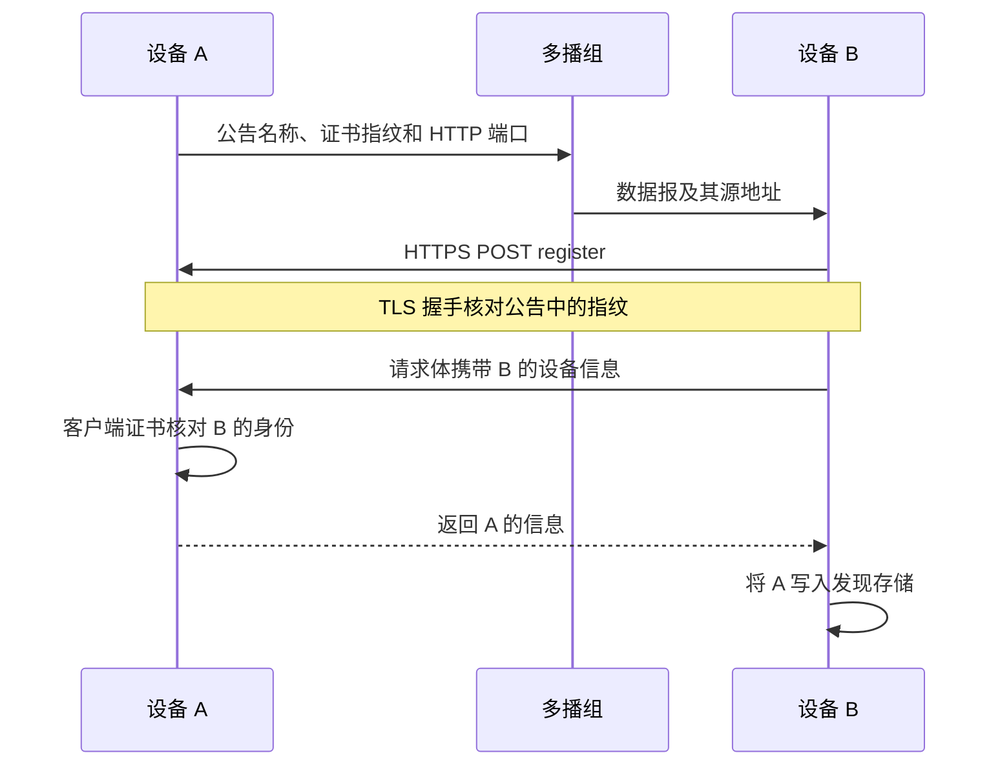
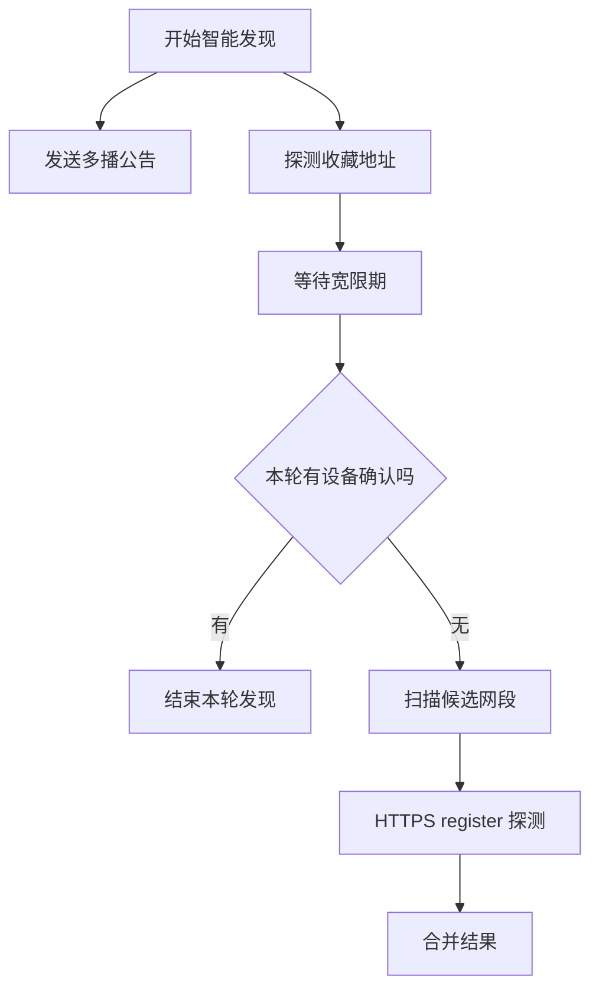
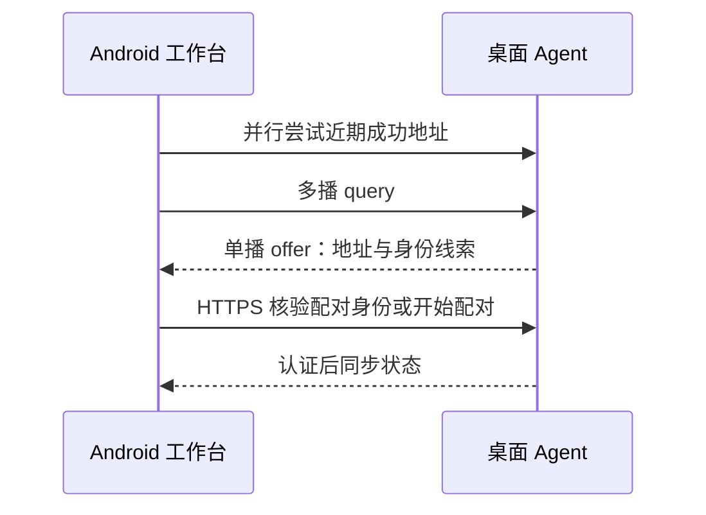

# LocalSend 局域网发现研究

研究快照：2026-10-16；基线 LocalSend v1.18.2 与 Protocol v2.2。本文从前期研究归档，初始化仓库时未重新核验上游版本。

LocalSend 使用自定义 UDP 多播发现，再通过 HTTP / HTTPS 双向登记确认设备。它还会探测收藏地址，在没有确认结果时扫描局部网段。工作台可借鉴分阶段发现机制，并将设备身份与地址分开保存。

## 查的是哪个版本，结论是什么

> **对 DeskBar 的建议**
>
> 将原方案的单一 mDNS 发现，调整为「UDP 发现 + 已配对地址探测 + 按需网段扫描」。mDNS 可留作后续 Adapter。Android 继续作为客户端，配对和远程操作授权仍然独立。

本次研究快照以 [v1.18.2](https://github.com/localsend/localsend/releases/tag/v1.18.2) 为主要证据。GitHub 返回发布时间为 2026-08-21；同时比对主分支提交 `d01fdb14c978fa8b2b13e29a50cc0feaefe5c1b9`。这次读取的发现、多播及设备存储核心文件，在两个版本中内容相同。

| 问题 | 源码结论 |
| --- | --- |
| 是否使用 mDNS / Bonjour 发现 | 发现链路使用自己的 UDP JSON 消息 |
| 是否需要中心服务器 | 本地发现与 HTTP 通信不依赖外部服务 |
| 默认网络参数 | IPv4 多播组 `224.0.0.167`；UDP / TCP 默认端口均为 `53317` |
| 是否只支持 IPv4 | 该版本还并行使用 IPv6 多播组 `ff12::fd3a:e420` |
| 发现后是否立即可信 | 多播先给出线索，HTTPS 核对证书；这仍不等于用户完成配对 |
| 谁承载实现 | Flutter 调用 Rust 发现模块，Rust 管 socket、探测和设备存储 |

默认组地址位于 `224.0.0.0/24`。官方协议与源码注释说明，这是为兼容部分 Android 设备。这个地址属于 LocalSend，新产品应确定自己的组和端口，不能直接混用它的发现网络。[协议默认值](https://github.com/localsend/protocol/blob/main/README.md#1-defaults)、[多播常量与说明](https://github.com/localsend/localsend/blob/v1.18.2/packages/core/src/multicast/mod.rs#L24-L48)

本次属于源码与协议分析，未运行 LocalSend，也未在我们的 Android / Windows 设备上验证发现成功率。

## 正常发现：多播通知，HTTP 双向登记

多播包包含 alias、version、deviceModel、deviceType、fingerprint、port、protocol 和 download。接收方使用 UDP 数据报的源 IP，再结合包内的服务端口发起登记；消息里无需另外声明一个可信 IP。[消息结构](https://github.com/localsend/localsend/blob/v1.18.2/packages/core/src/model/discovery.rs#L100-L144)

一个 `/register` 交互交换双方的信息。B 的出站请求确认 A 可达；A 从请求的对端地址和 B 声明的监听端口记录 B。A 在这个处理器里并未额外反向探测 B 的监听端口，所以双向登记不保证两个入站方向都可达。[登记处理器](https://github.com/localsend/localsend/blob/v1.18.2/packages/core/src/http/server/v2.rs#L154-L210)

发送不是只做一次：代码依次等待 100 ms、500 ms、2 s，再各发一次。按循环计算，发包约在启动公告后的 0.1、0.6、2.6 秒；这是重试时序，不能当成发现延迟实测值。[公告循环](https://github.com/localsend/localsend/blob/v1.18.2/packages/core/src/multicast/mod.rs#L218-L235)

**协议与实现有差异：** 官方 v2.2 文档允许 HTTP 登记失败后用 UDP 回应，且规定 announce=false 不再触发回应。但该版本 Rust 多播模块只发送公告、使用 HTTP 回应，没有实现这个 UDP 回应兜底。接收模型也不把 announce 作为分支条件，不能把协议中的两种回应都算成当前实现。[官方协议](https://github.com/localsend/protocol/blob/main/README.md#3-discovery)、[模块说明](https://github.com/localsend/localsend/blob/v1.18.2/packages/core/src/multicast/mod.rs#L1-L8)

## 多播不成功时，怎样继续找

| 环节 | 当前实现 |
| --- | --- |
| 低成本阶段 | 多播公告与收藏地址探测并行进行 |
| 升级条件 | 收藏探测完成后，再等 1 秒；仍没有新的确认事件才扫描 |
| 判定依据 | 本轮确认计数，已知设备重新确认也算成功 |
| 扫描范围 | 当前选出的 IPv4 地址的同前三段 `/24`，不是按实际掩码遍历整个子网 |
| 目标地址 | 最后一段从 0 到 255，跳过传入的本机地址 |
| 并发与超时 | 每次网段扫描最多 50 个探测；默认每次登记超时 500 ms |
| 多网卡数量 | 智能扫描入口最多选择 3 个本地地址；可手动选择网段 |
| 重复扫描 | 同一个接口地址正在扫描时，重复请求直接返回 |

源码入口：[智能扫描调度](https://github.com/localsend/localsend/blob/v1.18.2/app/lib/provider/network/scan_facade.dart#L10-L34)、[分阶段发现与网段扫描](https://github.com/localsend/localsend/blob/v1.18.2/packages/core/src/discovery/mod.rs#L296-L378)。

这不是每隔几秒无条件扫描整个局域网。它把较重的 HTTP 探测放在后面。多播 socket 启动失败时，HTTP 探测仍可独立工作。[发现启动接口](https://github.com/localsend/localsend/blob/v1.18.2/packages/localsend_isolates/rust/src/api/discovery.rs#L150-L165)

**对我们的改进建议：** 等待某台已配对电脑时，应按这台电脑是否找到决定下一步。另一台电脑已经回应，不能就停止寻找目标。扫描也应可取消、限制总时长，并提供明确的「进一步查找」入口。

## 多网卡、身份合并和网络恢复

| 实现细节 | 它解决什么 |
| --- | --- |
| 每个 IPv4 地址建立独立多播 socket | 每个 socket 单独指定发包网卡，避免都走系统默认路由 |
| 绑定通配地址，再按接口加入组 | 兼顾接收多播包与选择发送接口 |
| IPv6 按接口索引加入组 | 处理同一链路本地地址在不同接口上的含义 |
| TTL / hop limit 设为 1 | 将多播发现限制在本地链路 |
| 支持接口白名单 / 黑名单 | 用户可排除 VPN、虚拟网卡等不需要的接口 |
| 某个接口失败则跳过 | 单个不可用接口不会停掉其他接口的发现 |

对应实现：[socket 绑定与发包接口](https://github.com/localsend/localsend/blob/v1.18.2/packages/core/src/multicast/socket.rs#L20-L153)、[接口枚举与过滤](https://github.com/localsend/localsend/blob/v1.18.2/packages/core/src/util/interface.rs)。

**设备身份与地址分开存。** DeviceStore 按证书 fingerprint 合并设备，一个设备可有多个 `(host, port, protocol)` 通道。重新发现会更新通道、恢复可用状态并记录时间。通道排序先看可用性，再偏好 IPv6，最后比较最近确认记录。[设备与通道模型](https://github.com/localsend/localsend/blob/v1.18.2/packages/core/src/discovery/store.rs#L16-L111)

这也解释了为什么不能把 IP 当设备 ID。电脑同时接入有线和 Wi-Fi，或网络切换导致地址变化，仍然应显示为同一台电脑。源码里的 Available 只表示最后使用时成功；存储模型没有靠它证明设备此刻在线。[合并逻辑](https://github.com/localsend/localsend/blob/v1.18.2/packages/core/src/discovery/store.rs#L176-L256)

**恢复策略：** 多播接收连续出错会放弃对应 socket；全部失败时上报事件。Flutter 包装层会重启发现，并在异常停止时等待 1 秒以避免忙循环。配置变化也可以触发停止、释放端口、重新绑定。[Rust 接收循环](https://github.com/localsend/localsend/blob/v1.18.2/packages/core/src/multicast/mod.rs#L325-L392)、[Flutter 生命周期包装](https://github.com/localsend/localsend/blob/v1.18.2/packages/localsend_isolates/lib/src/task/discovery/discovery.dart#L47-L148)

这里仍需验证：App 本地 IP 列表目前过滤掉 IPv6，Windows connectivity 订阅也被跳过。因此「Rust 支持双栈和重绑」不能直接推导为所有界面、所有网络切换都已完整覆盖。[本地 IP 获取](https://github.com/localsend/localsend/blob/v1.18.2/app/lib/provider/local_ip_provider.dart#L46-L119)

## HTTPS 指纹有用，但发现不等于授权

| 路径 | 该版本的身份处理 |
| --- | --- |
| 已收到 HTTPS 公告 | 在 TLS 握手时固定公告声明的证书指纹，匹配后才发送登记内容 |
| 主动探测未知 IP | 先接受符合其证书规则的未知证书，再从 TLS 连接取得真实指纹 |
| 收到 HTTPS 登记请求 | 用客户端证书核对请求声称的 fingerprint，避免冒用其他设备的指纹 |
| HTTP 模式 | 指纹来自消息字段，不能提供同样的证书身份保证 |

来源：[握手阶段固定证书](https://github.com/localsend/localsend/blob/v1.18.2/packages/core/src/http/client/server_cert_verifier.rs#L46-L145)、[未知地址探测](https://github.com/localsend/localsend/blob/v1.18.2/packages/core/src/discovery/mod.rs#L142-L183)、[登记请求的客户端证书校验](https://github.com/localsend/localsend/blob/v1.18.2/packages/core/src/http/server/v2.rs#L154-L190)。

这些校验能确认连接对端持有相应私钥。初次发现仍无法凭多播就知道那是不是用户想连接的电脑。我们的 Agent 可以打开应用和会话，因此应继续使用扫码 / PAKE 配对、持久公钥信任和独立设备授权。

LocalSend 的 fingerprint 是整张证书的 SHA-256。我们可继续固定主机 SPKI，使同一密钥下的证书续期不改变身份。已配对电脑的候选地址要通过已有公钥验证，不能因为名称相同、IP 相同就更新信任。

Android 的网络权限也不能靠换发现协议跳过。该版 LocalSend 在启动服务器和发现之前请求局域网权限。我们的实现需按系统与 target SDK 处理授权、拒绝和恢复路径。[启动顺序](https://github.com/localsend/localsend/blob/v1.18.2/app/lib/config/init.dart#L190-L218)、[Android 权限实现](https://github.com/localsend/localsend/blob/v1.18.2/app/android/app/src/main/kotlin/org/localsend/localsend_app/MainActivity.kt#L128-L165)

## 具体怎样用到DeskBar 仓库

这是建议的新产品协议，不是 LocalSend 消息原样照搬。我们只需要桌面监听 HTTPS；Android 不必为了接收登记回调而再开 HTTP 服务器。桌面上线、网络变化时发有限次 offer，也可以回应 Android 的 query。query / offer 使用独立消息类型和随机 nonce，收到 offer 后不再相互触发回复。

| 决策 | 推荐做法 |
| --- | --- |
| 发现接口 | `start / stop / refresh`，输出候选设备及多地址；不向 UI 暴露 socket |
| 原生实现 | 桌面使用 Rust；Android 可经 JNI / Flutter Rust Bridge 共享小型发现模块 |
| 多播频率 | 启动、进入连接页、网络变化时短重试；加随机抖动与源地址限流 |
| 连接确认 | 多播只产候选；单独探测 HTTPS；配对后才下发状态与允许动作 |
| 已配对重连 | 优先并行尝试近期成功地址，逐个核对固定公钥 |
| 失败回退 | 无目标结果时提供受控的局部扫描；始终保留二维码和手工地址 |
| mDNS | 作为可替换的发现 Adapter；首版不同时维护两套主发现链路 |
| 在线判断 | 认证连接与心跳决定在线；发现结果与来源数据新鲜度分别处理 |

**端口方案需要随之调整。** 自定义多播需要固定的产品发现端口。若要在多播受阻时靠网段扫描找到新电脑，HTTPS 也应优先使用稳定默认端口；随机服务端口无法靠单端口扫描找全。占用时可自动换端口，但这类电脑要靠公告、已存地址、二维码或手工输入实际端口找到。

**不能指望多播方案解决所有网络。** mDNS 本身也使用多播，改为自定义 UDP 不保证绕过 AP 的多播限制。客户端隔离或防火墙阻断直连时，扫描也无法修复。选择 UDP 的主要理由是跨端实现可控、消息精简，并能复用 Rust 网络经验。

建议连接原型对比：137 Android 9、普通手机、macOS、Windows，以及 Wi-Fi / 有线双网卡、VPN、换 IP、多播受阻、端口占用。记录成功率、耗时和发包量后，再确定默认超时、重试和扫描阈值。

验证边界：已核对官方协议与两个源码版本；未宣称完成运行时或真机验证。相关结论已补入[原架构方案](../architecture.md)。
