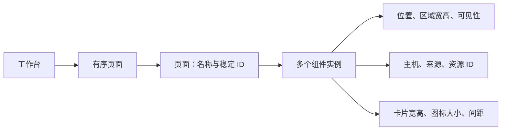
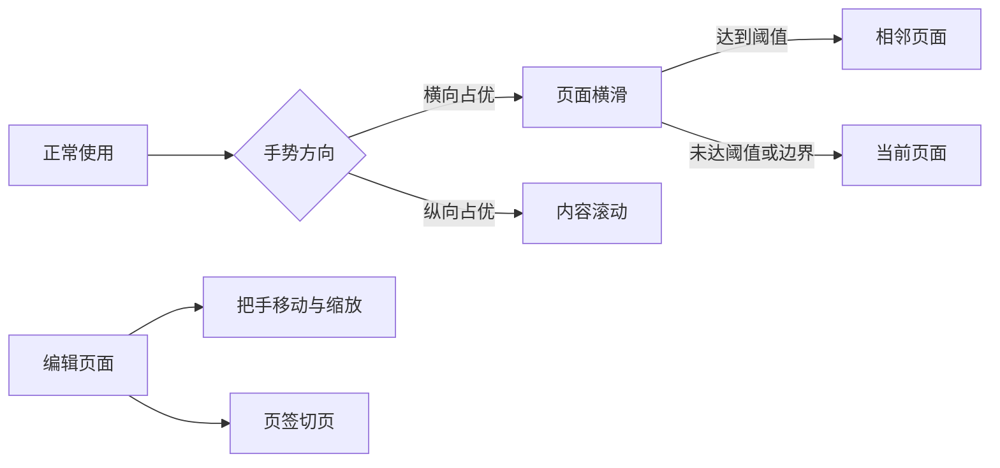

# 页面与可选组件

状态：目标行为与示例原型；2026-10-16。

工作台由多个页面组成，每页可以添加任意组件。页面没有类型，也不绑定某种布局。同类组件可以重复添加，位置、尺寸与参数各自独立。

[打开页面与组件原型](prototypes/workbench.html)。原型只使用示例数据，刷新会恢复初始状态。

## 页面是容器，组件才有能力



| 对象 | 用户可以做什么 | 规则 |
| --- | --- | --- |
| 页面 | 新建、重命名、调整顺序、删除、横滑切换 | 新页面从空白开始；至少保留一页 |
| 用量组件 | 选择额度或 API 用量，调整区域和标题 | 每个实例独立绑定来源 |
| 会话组件 | 调整卡片宽高、间距、信息密度 | 同页可放多个实例，分别显示已授权来源 |
| 快捷入口组件 | 调整图标大小、横纵间距、名称显示 | 可以是一行入口，也可独占整页 |

初始示例包含「总览」「任务」「应用」三页。这些只是可修改的页面名称，每页都能删除、添加或组合任意组件。用户新建的页面遵循相同规则。

「导航栏」在这里称为「快捷入口组件」。页面切换和编辑入口属于工作台自身，独立保留。隐藏所有组件后仍能打开编辑器。

## 区域大小与组件参数分开调整

| 范围 | 可调整的参数 | 调整后的行为 |
| --- | --- | --- |
| 所有组件 | 外框位置、区域宽高、标题、可见性 | 只影响当前实例，不修改其他组件 |
| 会话卡片 | 目标宽度、目标高度、卡片间距 | 根据组件可用空间重新计算列数和完整行数 |
| 会话显示 | 自动铺满完整行、标准或精简信息 | 保持文字可读；超出内容上下滚动 |
| 快捷入口 | 图标尺寸、横向间距、纵向间距、名称 | 保持设定图标大小，自动计算每行数量 |
| 用量显示 | 额度或 API 内容，后续可增加指标选择 | 小区域保留主指标，详情仍可打开 |

**会话宽高是卡片的目标尺寸。** 列数取可用宽度能容纳的整数，卡片均分整行。调整宽度不会改变组件外框，也不会修改另一个会话组件。

自动铺满完整行开启时，高度按目标值计算行数，再均分可见高度。关闭后保持目标高度，列表在内部滚动。系统大字号提高卡片最小高度，减少行数，不整体缩小文字。

**快捷入口保留设定的图标尺寸。** 图标变大时减少列数，内容过多时上下滚动。单个图标都放不下时，提示扩大组件或临时铺满，避免静默缩小。

原型以 CSS px 演示参数；Android 实现换成 dp，文字使用 sp。屏幕安全区、系统字号和触控目标需在真机验证。数据来源绑定是正式实现的设计项，原型只展示固定示例主机。

## 左右切页，上下滚动内容



| 场景 | 手势与反馈 |
| --- | --- |
| 正常使用 | 在空白、会话卡片或快捷入口上左右横滑切页 |
| 内容超出高度 | 组件内部上下滚动，不切换页面 |
| 横滑结束 | 抑制本次点击，避免打开会话或应用 |
| 切到第一页或最后一页 | 停在边界，不循环跳到另一端 |
| 编辑时 | 横滑不翻页；标题把手用于移动，右下角用于缩放 |
| 需要直接跳页 | 点击页面名称或底部页码；键盘左右键也可切页 |

全工作台只有一层横向翻页。快捷入口组件不再自行横向分页，避免内外两层手势争抢。触控板横向滚动也用于切页，并限制惯性连续翻页。

原型实现方向锁定、拖动跟随、距离阈值和点击抑制。正式 Android 可在此基础上增加速度判定与吸附动画，再验证边缘返回手势。

## 编辑流程与页面管理

| 操作 | 行为 |
| --- | --- |
| 进入编辑 | 点击边缘入口，或长按空白；创建所有页面的编辑草稿 |
| 添加组件 | 选择类型后创建新实例；允许重复，自动寻找空位 |
| 移动与缩放 | 网格吸附；不允许重叠或越界，也不推挤其他组件 |
| 隐藏或恢复 | 保留实例、参数和原位置；恢复冲突时提示先整理 |
| 整理本页 | 只重新铺排当前方向的可见组件，不影响其他页 |
| 临时铺满 | 保留原位置；还原时回到原组合，不改变页面配置 |
| 移到其他页 | 保留组件 ID、数据绑定和参数，在目标页寻找空位 |
| 删除页面 | 二次确认后移除页面及其组件；编辑中可撤销 |
| 完成或取消 | 完成提交整个草稿；取消恢复所有页面的编辑前状态 |

横竖屏各保存一份摆放位置，组件参数默认共用。旋转只切换摆放，不生成另一套页面列表。用户调整过的摆放不能被后续旋转覆盖。

原型采用宽屏 12 列、竖屏 4 列网格。新增和跨页移动会检查两种方向是否都有空间，失败不丢失原组件。正式实现可进一步提供自动整理或移到新页的快捷操作。

隐藏组件不结束电脑任务，也不撤销设备权限。编辑状态下点击内容仅选中组件，不能发送远程动作。退出沉浸与编辑入口始终保留至少 48 dp 的触控区域。

## 本机模型与模块边界

```json
{
  "schemaVersion": 2,
  "activePageId": "page-main",
  "pages": [
    {
      "id": "page-main",
      "name": "我的工作台",
      "widgets": [
        {
          "id": "session-work",
          "type": "sessions",
          "visible": true,
          "binding": {"hostId": "host-a", "source": "codex"},
          "placements": {
            "wide": {"x": 0, "y": 0, "w": 12, "h": 12},
            "portrait": {"x": 0, "y": 0, "w": 4, "h": 24}
          },
          "options": {
            "itemWidth": 280, "itemHeight": 96,
            "gap": 12, "fitRows": true
          }
        }
      ]
    }
  ]
}
```

数组顺序决定页面顺序，实例 ID 不随移动或改名变化。选中组件、拖动候选、临时铺满和撤销记录属于临时编辑状态，不写入组件配置。

| 模块 | 职责 |
| --- | --- |
| LayoutWorkspace | 管理页面、组件实例、草稿、撤销与提交 |
| LayoutRepository | Android 本机原子保存、版本迁移与恢复 |
| 布局求解 | 根据当前页、方向、安全区和最小尺寸计算矩形 |
| WidgetRenderer | 根据实例参数与矩形渲染卡片或图标网格 |
| WorkbenchStore | 按绑定提供已授权状态，执行有限动作 |

布局在 Android 本机保存，拖动、缩放和切页不需要电脑在线。绑定使用稳定主机与资源 ID，不存 IP、电脑应用路径或账号凭据。

多个组件共享同一状态来源时，由 WorkbenchStore 合并订阅。切页保留各组件的滚动位置；不可见页暂停高频渲染，缓存继续按来源新鲜度更新。

如果后续导入旧单画布配置，创建一个页面并迁入原实例、参数与摆放。先备份旧配置，迁移成功后再原子替换；未知组件保留配置并给出占位提示。

## 原型验证与正式实现范围

[打开交互原型](prototypes/workbench.html)，先在正常模式左右拖动，再进入编辑调整参数。

| 验证场景 | 预期结果 |
| --- | --- |
| 在卡片上横滑，再上下滚动 | 横滑切页且不执行动作；纵向只滚动内容 |
| 调整会话目标宽高 | 本实例行列改变，外框和其他实例参数保持原值 |
| 调整图标和横纵间距 | 当前入口网格变化，图标保持指定尺寸 |
| 新建空白页并添加同类组件 | 生成不同 ID，可各自设置与移到其他页 |
| 移动、隐藏、删除后撤销 | 恢复实例、参数和页面顺序 |
| 跨页修改后取消 | 所有页面回到进入本次编辑前的状态 |
| 切换横竖屏或窄窗口 | 页面列表相同，使用对应方向的摆放 |

仓库已收录可操作的 HTML 原型和设计说明，尚未实现 Android 的页面与组件编辑。原型使用内存状态，不包含正式保存、来源选择或真实设备动作。

Android 验收还需覆盖安全区、系统大字号、低高度横屏、边缘手势、息屏恢复和进程重启。持久化、迁移与动作权限需在正式代码中验证。


## 当前 Android 实现

已有单页总览，组合 Codex 额度、快捷入口和近期会话。会话最多 40 个，并展示非归档主会话总数；标题、项目与最近回合状态来自电脑，不能可靠读取时显示状态未知。卡片根据可用宽度排列，大字号下自然增高，上下滚动。网页 / 应用入口以文字按钮展示，符合 RawBlock 规范。

来源健康和更新时间独立于电脑连接。断线仍可查看上次快照，禁用打开；到额度重置时间显示等待刷新。手机通过校正后的电脑时间生成八秒有效请求；电脑返回 accepted 后，原生桥接查询同一 ID 的最终结果。无法确认时提示先查看电脑，不自动重发动作。

共享范围和打开权限在电脑逐设备设置，默认关闭。Android 缓存只含已授权字段，和配对凭据一并由 Keystore 加密；明确撤权时清理。当前未实现多页、组件增删 / 尺寸编辑、来源选择与布局保存，前文仍是这些功能的目标设计。
