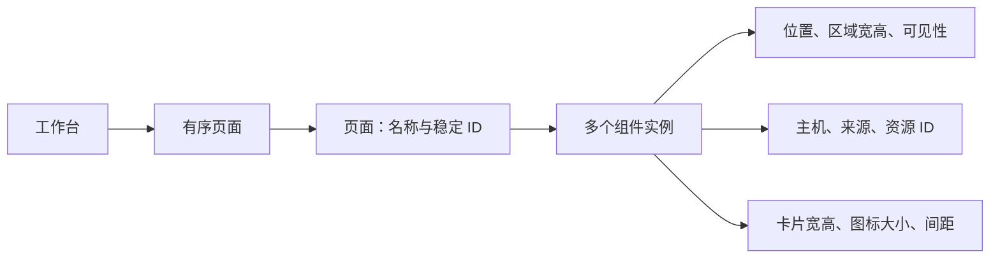
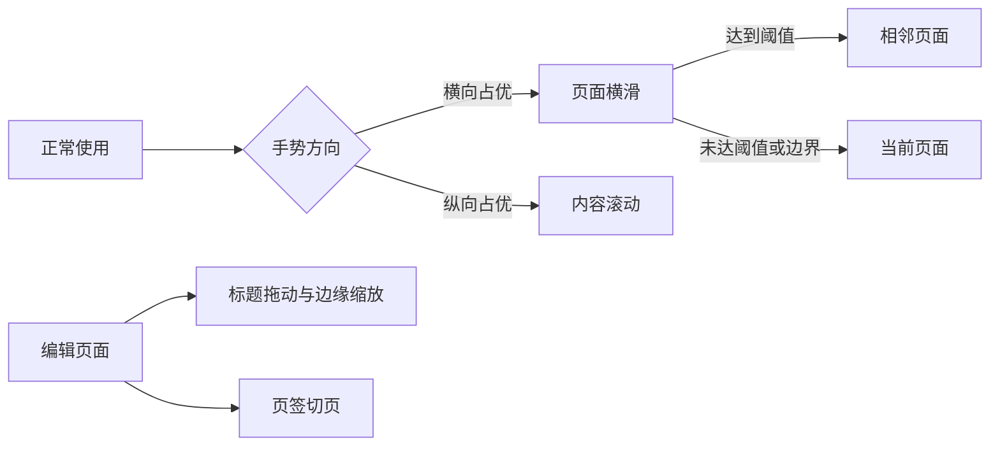

# 页面与可选组件

状态：单电脑 Android 多页工作台、组件编辑与本机保存已实现；验证边界见文末。2026-10-16。

工作台由多个页面组成，每页可以添加任意组件。页面没有类型，也不绑定某种布局。同类组件可以重复添加，位置、尺寸与参数各自独立。

[打开页面与组件原型](prototypes/workbench.html)。原型只使用示例数据，刷新会恢复初始状态；正常模式去装饰、长按编辑及浮动组件编辑器以本文和 Android 实现为准。

## 页面是容器，组件才有能力



| 对象 | 用户可以做什么 | 规则 |
| --- | --- | --- |
| 页面 | 新建、重命名、调整顺序、删除、横滑切换 | 新页面从空白开始；至少保留一页 |
| 用量组件 | 选择额度或 API 用量，调整区域和组件名称 | 每个实例独立绑定来源 |
| 会话组件 | 调整最多显示会话数、卡片宽高、间距、信息密度 | 数量默认 20，可设 1–40；每个实例独立保存 |
| 快捷入口组件 | 调整图标大小、横纵间距、名称显示 | 可以是一行入口，也可独占整页 |

初始示例包含「总览」「任务」「应用」三页。这些只是可修改的页面名称，每页都能删除、添加或组合任意组件。用户新建的页面遵循相同规则。

「导航栏」在这里称为「快捷入口组件」。页面切换和编辑手势属于工作台自身。正常模式不显示底部页码、页面示意或编辑按钮；长按页面空白或非交互内容进入编辑，隐藏所有组件后仍然可用。

## 区域大小与组件参数分开调整

| 范围 | 可调整的参数 | 调整后的行为 |
| --- | --- | --- |
| 所有组件 | 区域位置、宽高、组件名称、可见性 | 只影响当前实例，不修改其他组件 |
| 会话卡片 | 目标宽度、目标高度、卡片间距 | 根据组件可用空间重新计算列数和完整行数 |
| 会话显示 | 自动铺满完整行、标准或精简信息 | 保持文字可读；超出内容上下滚动 |
| 快捷入口 | 图标尺寸、横向间距、纵向间距、名称 | 保持设定图标大小，自动计算每行数量 |
| 用量显示 | 额度或 API 内容，后续可增加指标选择 | 小区域保留主指标，详情仍可打开 |

**会话宽高是卡片的目标尺寸。** 列数取可用宽度能容纳的整数，卡片均分整行。调整宽度不会改变组件外框，也不会修改另一个会话组件。

「最多显示会话数」替代单个会话筛选，按来源顺序显示最近的会话。未设数量的旧布局使用默认值，原有单会话筛选不再生效。

自动铺满完整行开启时，高度按目标值计算行数，再均分可见高度。关闭后保持目标高度，列表在内部滚动。系统大字号提高卡片最小高度，减少行数，不整体缩小文字。

**快捷入口保留设定的图标尺寸。** 图标变大时减少列数，内容过多时上下滚动。单个图标都放不下时，提示长按调整组件大小，避免静默缩小。

原型以 CSS px 演示参数；Android 实现换成 dp，文字使用 sp。屏幕安全区、系统字号和触控目标需在真机验证。数据来源绑定是正式实现的设计项，原型只展示固定示例主机。

## 左右切页，上下滚动内容



| 场景 | 手势与反馈 |
| --- | --- |
| 正常使用 | 在空白、会话卡片或快捷入口上左右横滑切页 |
| 内容超出高度 | 组件内部上下滚动，不切换页面 |
| 横滑结束 | 抑制本次点击，避免打开会话或应用 |
| 切到第一页或最后一页 | 停在边界，不循环跳到另一端 |
| 编辑时 | 横滑不翻页；拖动标题移动，拖动左右、下边缘或下角缩放 |
| 需要直接跳页 | 编辑模式使用页面菜单切页；正常模式支持键盘左右键 |

全工作台只有一层横向翻页。快捷入口组件不再自行横向分页，避免内外两层手势争抢。触控板横向滚动也用于切页，并限制惯性连续翻页。

原型实现方向锁定、拖动跟随、距离阈值和点击抑制。正式 Android 可在此基础上增加速度判定与吸附动画，再验证边缘返回手势。

## 编辑流程与页面管理

| 操作 | 行为 |
| --- | --- |
| 进入编辑 | 长按页面空白或非交互内容；创建所有页面的编辑草稿 |
| 添加组件 | 选择类型后创建新实例；允许重复，自动寻找空位 |
| 移动与缩放 | 细网格吸附；碰到其他组件时就近寻找空位，必要时连锁让位；放不下时保留原布局 |
| 隐藏或恢复 | 保留实例、参数和原位置；恢复冲突时提示先整理 |
| 整理本页 | 只重新铺排当前方向的可见组件，不影响其他页 |
| 移到其他页 | 保留组件 ID、数据绑定和参数，在目标页寻找空位 |
| 删除页面 | 二次确认后移除页面及其组件；编辑中可撤销 |
| 完成或取消 | 完成提交整个草稿；取消恢复所有页面的编辑前状态 |

横竖屏各保存一份摆放位置，组件参数默认共用。旋转只切换摆放，不生成另一套页面列表。用户调整过的摆放不能被后续旋转覆盖。

Android 使用横屏 48 × 48、竖屏 16 × 96 的细网格，步进为旧版的四分之一。拖动标题区域移动组件；左右边缘改变宽度，下边缘改变高度，两个下角同时改变宽高。最小区域宽约 96 dp、高约 48 dp；标题栏始终可操作。拖动中预览其他组件让位，松手后整体提交，一次撤销恢复所有受影响组件；取消手势或空间不足不修改草稿。仅调整当前页、当前方向的可见组件，保持其他组件尺寸和实例参数。新增和跨页移动仍检查两种方向是否都有空间。HTML 原型保留旧网格，仅作历史参考。

隐藏组件不结束电脑任务，也不撤销设备权限。编辑状态下点击内容仅选中组件，不能发送远程动作。标题栏和按钮保留至少 48 dp 高度；边缘使用 16 dp 宽的连续拖动区域与可见握柄。组件区域宽高和位置直接在画布调整，设置浮窗不再提供重复的尺寸、坐标和横竖屏摆放表单；会话卡片目标宽高、图标尺寸与间距等内容参数仍独立设置。正常模式组件不显示标题栏、描述、边框和全屏按钮，组件间仅留 2 dp 间距；会话自身的标题、项目和状态仍属于内容。

## 本机模型与模块边界

```json
{
  "schemaVersion": 3,
  "activePageId": "page-main",
  "pages": [
    {
      "id": "page-main",
      "name": "我的工作台",
      "widgets": [
        {
          "id": "session-work",
          "type": "sessions",
          "visible": true,
          "binding": {"hostId": "host-a", "source": "codex"},
          "placements": {
            "wide": {"x": 0, "y": 0, "w": 48, "h": 48},
            "portrait": {"x": 0, "y": 0, "w": 16, "h": 96}
          },
          "options": {
            "itemWidth": 280, "itemHeight": 96,
            "gap": 12, "fitRows": true
          }
        }
      ]
    }
  ]
}
```

布局版本 3 将旧版两个方向的坐标和宽高乘四，保留页面、实例 ID、参数与额外字段，迁移前备份原文件。数组顺序决定页面顺序，实例 ID 不随移动或改名变化。选中组件、拖动候选和撤销记录属于临时编辑状态，不写入组件配置。

| 模块 | 职责 |
| --- | --- |
| LayoutWorkspace | 管理页面、组件实例、草稿、撤销与提交 |
| LayoutRepository | Android 本机原子保存、版本迁移与恢复 |
| 布局求解 | 根据当前页、方向、安全区和最小尺寸计算矩形 |
| WidgetRenderer | 根据实例参数与矩形渲染卡片或图标网格 |
| WorkbenchStore | 按绑定提供已授权状态，执行有限动作 |

布局在 Android 本机保存，拖动、缩放和切页不需要电脑在线。绑定使用稳定主机与资源 ID，不存 IP、电脑应用路径或账号凭据。

多个组件共享同一状态来源时，由 WorkbenchStore 合并订阅。切页保留各组件的滚动位置；不可见页暂停高频渲染，缓存继续按来源新鲜度更新。

如果后续导入旧单画布配置，创建一个页面并迁入原实例、参数与摆放。先备份旧配置，迁移成功后再原子替换；未知组件保留配置并给出占位提示。

## 原型验证与正式实现范围

[打开交互原型](prototypes/workbench.html)，先在正常模式左右拖动，再进入编辑调整参数。

| 验证场景 | 预期结果 |
| --- | --- |
| 在卡片上横滑，再上下滚动 | 横滑切页且不执行动作；纵向只滚动内容 |
| 调整会话目标宽高 | 本实例行列改变，外框和其他实例参数保持原值 |
| 调整图标和横纵间距 | 当前入口网格变化，图标保持指定尺寸 |
| 新建空白页并添加同类组件 | 生成不同 ID，可各自设置与移到其他页 |
| 移动、隐藏、删除后撤销 | 恢复实例、参数和页面顺序 |
| 跨页修改后取消 | 所有页面回到进入本次编辑前的状态 |
| 切换横竖屏或窄窗口 | 页面列表相同，使用对应方向的摆放 |

仓库已收录可操作的 HTML 原型和正式 Android 实现。`LayoutWorkspace` 与 `LayoutRepository` 实现多页草稿、撤销 / 重做、双方向摆放、空间校验、本机原子保存、旧单画布迁移和损坏恢复；`WorkbenchCanvas` 实现手势、编辑器和实例渲染。原型继续只使用内存状态。

布局模型 / 仓库测试覆盖跨页取消、双方向空间不足、隐藏恢复冲突、随机编辑有效性、重启恢复、迁移备份、未知字段保留与未来版本防覆盖。Android 界面验收仍需覆盖安全区、系统大字号、低高度横屏、边缘手势与息屏恢复。


## 当前 Android 实现

初始提供可修改的「总览」「任务」「应用」三页，新建页为空白。组件可重复添加，组件名称、可见性、来源 / 资源、尺寸和显示参数各自独立。正常模式只展示内容，横滑或键盘切页，长按空白或非交互内容进入编辑。组件名称仅用于编辑识别，不额外显示为卡片标题；不展示底部页码、页面示意、编辑或全屏按钮。

编辑时顶部固定保留取消与完成，其余工具横向滚动。组件设置以非模态浮动窗口显示，画布保持完整尺寸，参数修改立即反映在预览中。拖动窗口顶部可移动位置，窗口限制在画布范围内，顶部取消与完成不被遮挡；表单内容在窗口内部滚动。切换组件时保留窗口位置和各实例的滚动位置，关闭窗口不取消草稿。旋转或键盘弹出后自动限制窗口位置与高度，关闭键盘后恢复可用空间。页面管理、组件列表、添加及显示设置仍使用横屏右侧、竖屏下方的工具区。组件标题区域可拖动移动，左右和下边缘可拖动缩放，下角支持同时缩放宽高；碰撞时预览就近让位，小区域或隐藏组件可从列表选中恢复。页面删除需确认，全部编辑仍支持撤销 / 重做。

会话最多 40 个，正常时不展示数量和重复更新时间说明；实际来源失败、过期或离线仍明确提示。状态未知保持未知，目标宽高、间距、完整行铺满与精简信息按实例设置。快捷入口同步电脑应用的 PNG 图标，可在电脑选择或更换；未取得图标时使用通用图形。电脑端入口管理采用图标网格，右键打开编辑 / 删除菜单，拖动后自动保存顺序；Alt + 左右方向键也可排序，Enter 或 Shift + F10 可打开菜单。删除前确认，编辑使用弹窗并保留未保存草稿及错误提示；排序失败保持原顺序，设备按电脑保存的顺序展示入口，排序不改变入口的打开目标与动作版本。图标保持用户设定尺寸，空间不足时提示长按调整。用量组件保留主指标、重置与旧数据状态，点击可打开详情，不附加「查看详情」说明。两种主题遵循 [视觉规范](../DESIGN.md)，本机保存后重启恢复。

显示设置位于编辑工具中的「显示」面板。工作台默认沉浸显示，自动跟随传感器旋转；「锁定旋转」默认关闭，开启后固定当前方向，关闭后恢复自动旋转。沉浸与方向锁定均在本机保存，与页面草稿、主题、共享权限和远程动作独立。Android 使用 FULL_SENSOR，无需修改系统的自动旋转开关；横竖屏切换对应摆放。

来源健康和更新时间独立于电脑连接。断线仍可查看上次快照，禁用打开；到额度重置时间显示等待刷新。手机通过校正后的电脑时间生成八秒有效请求；电脑返回 accepted 后，原生桥接查询同一 ID 的最终结果。打开成功保持静默，失败或无法确认时才在屏幕顶部安全区显示短提示；无法确认时提醒先查看电脑，不自动重发动作。其他操作的短提示也统一显示在顶部，不挤动画布。

共享范围和打开权限在电脑逐设备设置，默认关闭。Android 缓存只含已授权字段，和配对凭据一并由 Keystore 加密；明确撤权时清理。布局另存 App 私有目录，只含稳定 ID 与显示偏好，离线编辑不需要电脑。打开动作仅接受授权来源的资源 ID；编辑时禁用，绑定电脑不匹配时不回退到当前电脑。

完成编辑先原子保存，再提交整个草稿；保存期间禁止修改或返回取消，失败保留草稿供重试。取消恢复进入本轮编辑前的全部页面。切页保存当前页，横竖屏只切换摆放；未知组件和额外字段保留，较新布局版本只读，旧布局迁移前保留原始备份。测试与设备证据见 [跨端验证](../tests/README.md)，完整物理设备边缘手势、息屏及系统回收仍需现场验收。
